# Low-maintenance Azure Container Apps spoke

A preconfigured, private **spoke** for hosting many small apps on Azure Container Apps, with
**Azure AI Foundry**, **Azure Monitor alerting** and two **Azure SRE Agents** (L1 triage, L2 responder),
deployed with one command (`azd provision`).

It's simplified from the [Azure Container Apps landing zone accelerator](https://github.com/Azure/ACA-Landing-Zone-Accelerator)
(`aca-internal` scenario). It's built from [Azure Verified Modules](https://aka.ms/avm) pinned to exact versions,
so Microsoft maintains the resource plumbing (diagnostics, private endpoints, RBAC). The SRE agents follow the
official [microsoft/sre-agent](https://github.com/microsoft/sre-agent) IaC templates.



## What you get

| Area | Resources |
|---|---|
| **Network (spoke)** | VNet `10.1.0.0/22` with `snet-aca` (delegated, UDR → hub firewall), `snet-pep` (private endpoints), `snet-sre-l1`/`snet-sre-l2` (SRE agents), optional `snet-agw`. NSGs on every subnet, peering to the hub |
| **Apps hosting** | One internal Container Apps environment (workload profiles, Consumption). Every app gets `<app>.<apps domain>` and its own alert rules automatically |
| **AI** | Foundry (`AIServices`) account, one project and configurable model deployments. Private endpoint only, Entra ID auth only |
| **Shared services** | ACR Premium, Key Vault (RBAC), one shared user-assigned identity, Log Analytics, Application Insights |
| **Private DNS** | Spoke-owned `privatelink.*` zones linked to spoke + hub, **or** your central zones (`privateDnsZoneMode = 'Existing'`) |
| **Ingress (optional)** | App Gateway WAF_v2 with **one wildcard listener**, so adding an app never needs a gateway change |
| **Operations** | Azure Monitor alert rules for every platform resource and app, an on-call action group, and two Azure SRE Agents that work the alerts as tickets (see [Operations](#operations-azure-monitor--sre-agents)) |
| **Test hub (optional)** | VNet, Azure Firewall Basic with ACA and SRE agent egress rules, Bastion, optional jumpbox, for standalone labs |

See [docs/traffic-flows.svg](docs/traffic-flows.svg) for ingress, private endpoint, egress and DNS flows, and
[docs/sre-operations.svg](docs/sre-operations.svg) for the alert → ticket → agent flow.

## Quick start

Prerequisites: Azure CLI, Azure Developer CLI (`azd`), PowerShell 7, and Owner (or Contributor + User Access
Administrator) on the subscription. The region must support Azure SRE Agent (for example `swedencentral`,
`eastus2`, `uksouth`; see [supported regions](https://learn.microsoft.com/azure/sre-agent/supported-regions)),
or set `DEPLOY_SRE_AGENTS=false`.

```powershell
azd auth login
az login --scope "https://azuresre.dev/.default"   # data-plane token used to configure the SRE agents
azd env new dev                      # environment name: 2-6 chars
azd env set AZURE_LOCATION swedencentral
azd env set ALERT_EMAILS "oncall@contoso.com"       # Sev0/Sev1, Resource Health and Service Health e-mails

# Choose ONE connectivity mode:
#  a) Standalone lab with the built-in test hub
azd env set DEPLOY_TEST_HUB true
azd env set JUMPBOX_SSH_PUBLIC_KEY "$(Get-Content ~/.ssh/id_rsa.pub)"   # optional jumpbox
#  b) Your platform hub
azd env set HUB_VNET_RESOURCE_ID /subscriptions/.../virtualNetworks/vnet-hub
azd env set HUB_FIREWALL_PRIVATE_IP 10.0.0.4
#  c) Neither: an isolated spoke (no peering, no forced egress)

azd provision                        # deploys the platform, then configures the SRE agents (postprovision hook)
./scripts/deploy-app.ps1 -Name hello # deploys the sample app (with its alert rules)
```

`azd provision` is idempotent. Re-run it after changing any setting.

## Configuration

Everything is in [infra/main.bicepparam](infra/main.bicepparam). The common switches can also be set as azd
environment values, so you don't have to edit the file:

| azd env value | Parameter | Default | Purpose |
|---|---|---|---|
| `WORKLOAD_NAME` | `workloadName` | `lowmaint` | Prefix for all names (≤10 chars) |
| `AZURE_ENV_NAME` | `environmentName` | `dev` | Environment (≤6 chars) |
| `DEPLOY_TEST_HUB` | `deployTestHub` | `false` | Minimal hub for labs |
| `HUB_VNET_RESOURCE_ID` | `hubVnetResourceId` | – | Existing platform hub |
| `HUB_FIREWALL_PRIVATE_IP` | `hubFirewallPrivateIp` | – | Next hop for `0.0.0.0/0` |
| `APPS_DNS_SUFFIX` | `appsDnsSuffix` | – | Custom apps domain, e.g. `apps.contoso.com` |
| `APPS_CERTIFICATE_NAME` | `appsCertificateName` | – | Wildcard cert in Key Vault |
| `DEPLOY_APP_GATEWAY` | `deployAppGateway` | `false` | WAF entry point (needs custom domain) |
| `ALERT_EMAILS` | `alertEmailAddresses` | – | Comma-separated on-call e-mail addresses |
| `DEPLOY_SRE_AGENTS` | `deploySreAgents` | `true` | L1 + L2 Azure SRE Agents |
| `SRE_AGENT_NETWORK_MODE` | `sreAgentNetworkMode` | `AzureVNet` | `AzureVNet` (egress via spoke subnets and hub firewall) or `Unrestricted` |
| `SRE_OPERATORS_GROUP_ID` | `sreOperatorsGroupId` | – | Entra group that may chat with the agents (SRE Agent Standard User) |

Other parameters (edit `main.bicepparam`): `spokeAddressSpace`, `spokeSubnets`, `spokeDnsServers`,
`createHubSidePeering`, `privateDnsZoneMode` + `existingPrivateDnsZoneIds`, `linkPrivateDnsZonesToHub`,
`deployFoundry`, `foundryModelDeployments`, `appGatewayFrontend` (`Public`/`Private`), `appGatewayWafMode`,
`zoneRedundant`, `logRetentionInDays`, `sreDefaultModelProvider`, `sreDefaultModelName`,
`sreMonthlyAgentUnitLimits`, `sreUpgradeChannel`.

### IP plan

| Range | Use |
|---|---|
| `10.0.0.0/24` | Test hub: firewall `/26`, firewall mgmt `/26`, Bastion `/26`, jumpbox `/27` |
| `10.1.0.0/23` | `snet-aca`, Container Apps (delegated to `Microsoft.App/environments`) |
| `10.1.2.0/26` | `snet-pep`, private endpoints |
| `10.1.2.64/27` | `snet-sre-l1`, SRE agent L1 egress (delegated to `Microsoft.App/environments`) |
| `10.1.2.96/27` | `snet-sre-l2`, SRE agent L2 egress (delegated to `Microsoft.App/environments`) |
| `10.1.2.128/25` | Spare |
| `10.1.3.0/24` | `snet-agw`, App Gateway (only if enabled) |

### Connecting to a platform hub

- **Egress:** a UDR on `snet-aca` and the SRE subnets sends `0.0.0.0/0` to `hubFirewallPrivateIp`. Allow the ACA
  and SRE agent FQDNs in your firewall; the rule collections in [test-hub.bicep](infra/modules/test-hub.bicep)
  (`aca-egress`, `sre-agent-egress`) are a ready-made list.
- **Peering:** both sides are created when `createHubSidePeering = true` (needs Network Contributor on the hub VNet).
  Otherwise only the spoke side is created and the platform team creates the hub side.
- **DNS:** spoke-owned zones are linked to the hub VNet so the hub DNS resolver can answer for them. If the hub
  already links central `privatelink.*` zones, use `privateDnsZoneMode = 'Existing'` (or `linkPrivateDnsZonesToHub = false`).
  If the hub uses a DNS resolver, set `spokeDnsServers` to its inbound IP.

### Custom apps domain and App Gateway (phase 2)

The environment needs its wildcard certificate in Key Vault *before* it can use a custom domain, so this is a second step:

```powershell
# Lab: self-signed cert (temporarily allows your IP on Key Vault, then locks it again)
./scripts/new-lab-cert.ps1 -DnsSuffix apps.contoso.com -EnableAppGateway
azd provision
```

For production, import a CA-issued `*.apps.contoso.com` certificate into Key Vault, then set `APPS_DNS_SUFFIX`,
`APPS_CERTIFICATE_NAME` and `DEPLOY_APP_GATEWAY`. Create a public DNS record `*.apps.contoso.com` pointing to the
`APP_GATEWAY_IP` output.

### Foundry

`foundryModelDeployments` defaults to a single `gpt-5-mini` GlobalStandard deployment. Model availability and
versions change by region; adjust the array before deploying. Apps get `FOUNDRY_PROJECT_ENDPOINT` and
`AZURE_OPENAI_ENDPOINT` and authenticate with the shared managed identity (`Azure AI User`,
`Cognitive Services OpenAI User`). The deploying user gets `Azure AI Developer`. The account is reachable only
through its private endpoint (for example from the jumpbox, or a VPN/ExpressRoute client via the hub).

## Operations: Azure Monitor + SRE agents



### Azure Monitor is the ticketing system

| Ticket concept | Azure Monitor |
|---|---|
| Ticket | Fired alert instance |
| Priority | Severity Sev0 … Sev4 |
| Status | `New` → `Acknowledged` → `Closed` |
| Work notes | Comment on each state change, prefixed with a tag: `[L1-TRIAGE]`, `[L1-CLOSE]`, `[ESCALATE-L2]`, `[L2-ACCEPT]`, `[L2-ACTION]`, `[L2-RESOLVED]`, `[HUMAN-NEEDED]` |
| Assignment | Severity-based response plans: Sev0–1 → L2, Sev2–4 → L1 |
| Paging | Action group `ag-<workload>-oncall-<env>` e-mails `ALERT_EMAILS` for Sev0–1, Resource Health and Service Health |

The full operating model given to both agents is in [sre/shared/operating-model.md](sre/shared/operating-model.md).

### Alert catalog (all in IaC)

| Rule | Source | Sev | Owner |
|---|---|---|---|
| `agw-no-healthy-backend` | App Gateway `HealthyHostCount < 1` | 0 | L2 + on-call |
| `aca-replica-crashloop` | Log alert on `ContainerAppSystemLogs_CL` | 1 | L2 + on-call |
| `afw-health` | Hub firewall `FirewallHealth < 90%` (test hub) | 1 | L2 + on-call |
| `aca-env-cores-quota` | ACA environment cores quota > 80% | 2 | L1 |
| `kv-availability` | Key Vault availability < 99% | 2 | L1 |
| `foundry-server-errors` | Foundry `ServerErrors` > 10 / 5 min | 2 | L1 |
| `agw-backend-5xx` | App Gateway backend 5xx > 25 / 5 min | 2 | L1 |
| `afw-snat` | Hub firewall SNAT > 80% (test hub) | 2 | L1 |
| `app-<name>-http-5xx` | Per app: `Requests` 5xx > `http5xxThreshold` / 5 min | 2 | L1 |
| `kv-saturation`, `foundry-throttling`, `appi-exceptions-spike` | Saturation / 429s / exception spikes | 3 | L1 |
| `app-<name>-cpu-high`, `app-<name>-memory-high` | Per app: > 85% for 15 min | 3 | L1 |
| `resource-health`, `service-health` | Activity log (Resource / Service Health) | 4 | L1 + on-call |

Platform rules live in [infra/modules/alerts.bicep](infra/modules/alerts.bicep). Per-app rules come from
[apps/_shared/container-app.bicep](apps/_shared/container-app.bicep) (`enableAlerts`, `http5xxThreshold`).

### Two agents, fixed skill levels

| | **L1 Triage** (`sre-<workload>-l1-<env>`) | **L2 Responder** (`sre-<workload>-l2-<env>`) |
|---|---|---|
| Handles | Sev2–Sev4 (response plan `l1-sev2-to-sev4`, autonomous) | Sev0–Sev1 (response plan `l2-sev0-to-sev1`, **review**) and L1 escalations |
| Azure RBAC | Reader, Log Analytics Reader, Monitoring Reader on spoke (+ test hub) | Same + **Container Apps Contributor** and Monitoring Contributor on the spoke |
| Alert lifecycle | Monitoring Contributor on the subscription (acknowledge/close) | Same |
| Custom agents | `l1-triage`, `l1-reporter` | `l2-incident-commander` → `l2-aca-remediator`, `l2-network-diagnostician` |
| Allowed writes (guard hook) | Alert state + note only | Remediator: revision restart/activate/deactivate, traffic shift, scale/resize. Commander: alert state + note |
| Never | Any resource change | Delete, network, RBAC, Key Vault, images, env vars, secrets (recommended as `[HUMAN-NEEDED]`) |
| Scheduled tasks | Daily health digest (weekdays 07:00 UTC), weekly alert-noise review | Escalation sweep (every 30 min), weekly reliability review |

Skill levels are enforced twice: by **Azure RBAC** on the agent identities, and by a **PreToolUse guard hook**
([sre/hooks/skill-level-guard.py](sre/hooks/skill-level-guard.py)) on every custom agent. Writes need approval from
an **SRE Agent Administrator** (`adminPrincipalId`, the deploying user by default) because the agent mode is Review.

### How the agents are configured

| Layer | Where | Applied by |
|---|---|---|
| Agents, identities, RBAC, App Insights/Log Analytics connectors, Azure Monitor incident platform, VNet egress | [infra/modules/sre-operations.bicep](infra/modules/sre-operations.bicep), [sre-agent.bicep](infra/modules/sre-agent.bicep) | `azd provision` |
| Knowledge, skills, custom agents + hooks, response plans, scheduled tasks | [sre/](sre) (`l1/manifest.json`, `l2/manifest.json`, markdown) | [scripts/configure-sre-agents.ps1](scripts/configure-sre-agents.ps1) (azd `postprovision` hook) |

To change agent behaviour, edit the markdown or manifests under `sre/` and re-run
`./scripts/configure-sre-agents.ps1` (idempotent). Preview the payloads without Azure with `-DryRun`.
If the data-plane step reports a token error, run `az login --scope "https://azuresre.dev/.default"` and re-run the script.

### Cost

Each SRE agent has an always-on charge of 4 Azure Agent Units (AAU) per hour (about 2,920 AAU per agent per month),
plus active-flow AAUs for the tokens it uses. `sreMonthlyAgentUnitLimits` caps active flow (defaults: L1 3,000,
L2 5,000). The escalation sweep runs every 30 minutes, so lower its frequency in `sre/l2/manifest.json` if cost
matters more than latency. See [pricing](https://learn.microsoft.com/azure/sre-agent/pricing-billing). Set
`DEPLOY_SRE_AGENTS=false` to keep only Azure Monitor alerting.

> The agents use the `Microsoft.App/agents@2025-05-01-preview` API, as the official templates do. VNet egress and
> AAU limits are not yet exposed in the GA `2026-01-01` API.

## Apps

Each app is one small parameter file. See [apps/README.md](apps/README.md).

```powershell
./scripts/new-app.ps1 -Name orders -Image <acr>.azurecr.io/orders:1.0.0 -Port 8080
./scripts/deploy-app.ps1 -Name orders
```

## Repository layout

```
azure.yaml                 azd project (platform + postprovision hook for the SRE agents)
bicepconfig.json           linter: flags outdated AVM modules / API versions
infra/
  main.bicep               subscription-scope entry point, feature toggles
  main.bicepparam          defaults (reads azd env values)
  naming.bicep             one naming convention shared by platform and apps
  modules/                 test-hub, spoke-network, private-dns, monitoring, shared-services,
                           aca-environment, foundry, app-gateway, alerts,
                           sre-operations, sre-agent, rbac-rg, rbac-subscription
apps/
  _shared/container-app.bicep   the only app template (includes per-app alerts)
  hello/main.bicepparam         sample app
sre/
  shared/                  operating model, platform context, ground rules (knowledge)
  hooks/                   skill-level guard hook
  l1/, l2/                 manifest.json + skills/ + agents/ per agent
scripts/                   deploy-app, new-app, new-lab-cert, configure-sre-agents
tools/mermaid/             Azure icon pack for Mermaid + renderer
docs/                      architecture, traffic flows, SRE operations (.mmd source, .svg/.png rendered)
```

## Keeping it low-maintenance

- **Updates:** `az bicep build --file infra/main.bicep` warns (`use-recent-module-versions`) when a newer AVM
  version exists. Bump the version string, rebuild, then `azd provision`.
- **No secrets in code:** identities and Key Vault references only. Local auth is disabled on Foundry, and the ACR admin user is off.
- **One log sink:** every resource, including the SRE agents' telemetry, sends to the same Log Analytics workspace.
- **Tune alerts, don't silence them:** the L1 weekly noise review proposes IaC threshold changes, and the L2 weekly
  reliability review lists drift left by manual mitigations.
- **Validate without deploying:** `az bicep build --file infra/main.bicep`,
  `az bicep build-params --file apps/<name>/main.bicepparam`, and `./scripts/configure-sre-agents.ps1 -DryRun`.
  Use `azd provision --preview` for a what-if.

## Removed compared with the upstream accelerator

Terraform and ARM copies, sample app suites, Redis, Front Door, the custom Azure Policy set, the spoke jumpbox,
Dapr instrumentation, telemetry deployments, the JSON naming engine, and the ADO/GitHub pipelines (azd covers
deployment).

## Sharing this repository

Keep subscription and tenant IDs, principal IDs, hub resource IDs, real domains and on-call addresses in
your local azd environment (`azd env set`), not in committed parameter files. The checked-in network
ranges and resource names are example defaults. The role-definition GUIDs in the templates are public
Azure built-in role IDs, not credentials.

Git ignores local azd state, `.env` files, registry credentials, local parameter overrides, certificates,
private keys, logs and SRE preview payloads. Ignore rules do not protect files that are already tracked.
Keep example logs synthetic, and review rendered diagrams and deployment output before sharing.

Before making a repository or copy public:

- Review `git status --short`, the tracked files, and all branches and tags you intend to publish.
- With [Gitleaks](https://github.com/gitleaks/gitleaks) installed, run
  `gitleaks git . --log-opts="--branches --remotes --tags" --redact` and
  `gitleaks dir . --redact`. The configuration excludes only two public Key Vault role IDs in their
  template; it keeps the default credential detection rules.
- Review commit author and committer metadata with `git log --format=fuller`. Changing a file or your
  current Git email does not remove old email addresses, package-feed URLs or other details from history.
  If history contains details you do not want public, use a reviewed clean-history copy or arrange an
  explicit history rewrite before publishing. Rotate any exposed credentials even if removed later.
- Confirm you have permission to publish the code and choose a license for your own contributions.
  No repository-wide license is currently included. The upstream
  [ACA landing zone accelerator](https://github.com/Azure/ACA-Landing-Zone-Accelerator) and
  [SRE Agent templates](https://github.com/microsoft/sre-agent) have their own licenses and notices.
  The [Azure Architecture Icons terms](https://learn.microsoft.com/azure/architecture/icons/) apply to
  the icon pack and the icons embedded in rendered diagrams.

Credential scans cannot prove that a repository contains no confidential information or establish
permission to publish it. Changing repository visibility is a separate, manual step.

## Diagrams

Diagrams are Mermaid sources in [docs/](docs) and use the official Azure Architecture Icons through a local
icon pack (`azure:*`). See [tools/mermaid/README.md](tools/mermaid/README.md).
