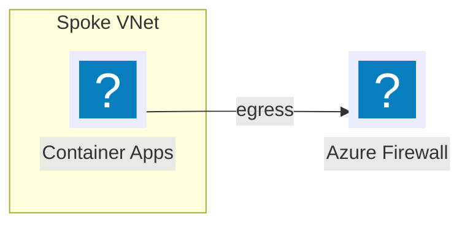

# Azure icons for Mermaid

This folder turns the official [Azure Architecture Icons](https://learn.microsoft.com/azure/architecture/icons/)
(V24) into an [Iconify](https://iconify.design/docs/types/iconify-json.html) icon pack with the prefix `azure`. Mermaid
can then use the icons in `architecture-beta` diagrams and as flowchart icon shapes.

| File | Purpose |
|---|---|
| `azure-icons.json` | Generated icon pack (637 icons) |
| `icon-index.md` | All icon names by category, e.g. `container-apps-environments`, `ai-foundry`, `firewalls` |
| `build-azure-iconpack.mjs` | Downloads the official zip and regenerates the pack |
| `render.mjs` | Renders `docs/*.mmd` to `.svg` + `.png` with the pack |
| `mermaid.config.json` | Shared theme |

## Usage

```powershell
cd tools/mermaid
npm ci --registry=https://registry.npmjs.org # once, using the public npm lockfile
npm run build-icons    # only when Microsoft publishes a new icon set (update the URL in the script)
npm run render         # renders all docs/*.mmd
```

```mermaid
architecture-beta
  group spoke(azure:virtual-networks)[Spoke VNet]
  service cae(azure:container-apps-environments)[Container Apps] in spoke
  service aif(azure:ai-foundry)[AI Foundry] in spoke
  cae:R --> L:aif
```





Use `flowchart` for anything with more than a few groups: its layout is deterministic. `architecture-beta`
places groups automatically from edge directions and stretches the canvas when edges between nested groups
conflict, so keep it for small views.

GitHub's and VS Code's built-in Mermaid renderers can't load custom icon packs, so documentation embeds the
rendered SVG and keeps the `.mmd` file as the source. Microsoft's icon terms of use apply: use the icons in
architecture diagrams only and don't modify them.
